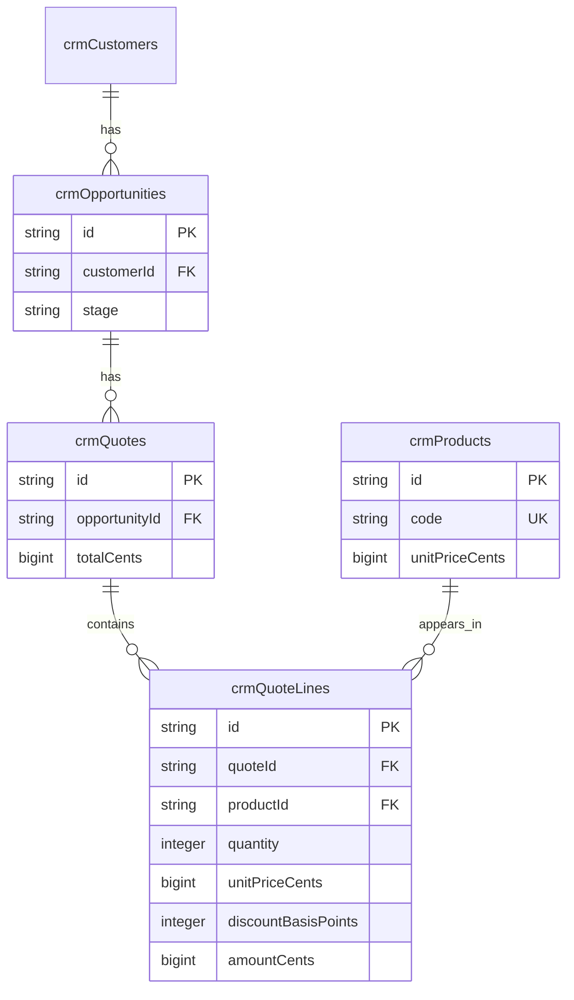

# Lesson 5 sales model

This model extends the customers, contacts, and follow-ups present at `lesson-4`. It describes the schema and save behavior at `lesson-5`; later lessons add ownership and approval fields.

## Key field dictionary

All four new collections use a required `string(64)` primary key named `id`. Fields below are required at the database level. Products, opportunities, and quotes also have required `createdAt` and `updatedAt` datetime fields. Quote lines have a required integer `position` for ordering.

| Collection         | Fields                                                           | Meaning and database constraints                                |
| ------------------ | ---------------------------------------------------------------- | --------------------------------------------------------------- |
| `crmProducts`      | `name: string(120)`, `code: string(40)`                          | Product name and unique product code                            |
| `crmProducts`      | `unitPriceCents: bigInt`                                         | Current catalog price in integer USD cents                      |
| `crmOpportunities` | `customerId: string(64)`                                         | Indexed foreign key to `crmCustomers.id`; restrict deletion     |
| `crmOpportunities` | `name: string(120)`, `stage: string(20)`, `notes: text`          | Sale name, stage classification, and notes                      |
| `crmQuotes`        | `opportunityId: string(64)`                                      | Indexed foreign key to `crmOpportunities.id`; restrict deletion |
| `crmQuotes`        | `name: string(120)`, `currency: string(3)`, `totalCents: bigInt` | Quote name, USD currency, and sum of rounded line amounts       |
| `crmQuoteLines`    | `quoteId: string(64)`, `productId: string(64)`                   | Indexed foreign keys to quote and product; restrict deletion    |
| `crmQuoteLines`    | `productName: string(120)`, `productCode: string(40)`            | Product descriptions copied for the quote                       |
| `crmQuoteLines`    | `quantity: integer`, `unitPriceCents: bigInt`                    | Offered quantity and the price saved for this line              |
| `crmQuoteLines`    | `discountBasisPoints: integer`, `amountCents: bigInt`            | Percentage discount in basis points and calculated line amount  |

Quantity and discount describe the offer, not the product. The product reference identifies the selected product; the copied price preserves the offer when catalog prices change. A product may appear more than once on a quote with different prices.

## From the model to migrations

- [Sales model migration](../database/main/migrations/202611120001_sales_model.ts) creates these four collections, physical foreign keys, and indexes without replacing customer tables.
- [Sales relations migration](../database/main/migrations/202611120002_sales_relations.ts) adds matching Collection `hasMany` and `belongsTo` metadata. `constraints(false)` avoids creating duplicate physical constraints; it does not remove the existing foreign keys.
- [Sales service](../server/providers/sales.ts) validates inputs, reads related records, saves price snapshots, and calculates amounts. A migration creates the storage; it does not perform future quote saves.

## Save rules

The service validates quantities from 1 to 10,000; unit prices from USD 0 to 100,000 with at most two decimal places; discounts from 0 to 100% with at most two decimal places; and 1 to 100 lines. These ranges are application validation, not database check constraints.

`100.00` USD is stored as `10000` cents; a `10%` discount is `1000` basis points. Compute each line as quantity × price × (1 − discount), round half up to cents, then sum rounded line amounts. Totals are calculated on the server. Tax, shipping, and currency conversion are outside this lesson.

On creation, selecting a product fills the form with its current price; the price is saved on the line and can be adjusted for that offer. If a create API request omits the price, the service uses the current catalog price. Updates must explicitly supply every line's saved price; omitting it is rejected. The transaction supplied by the submission route saves the header, lines, and total together. Merely rereading a quote never refreshes its prices from the catalog.

For setup, retained-data checks, and test commands, see [Lesson 5](lesson-5.md).
